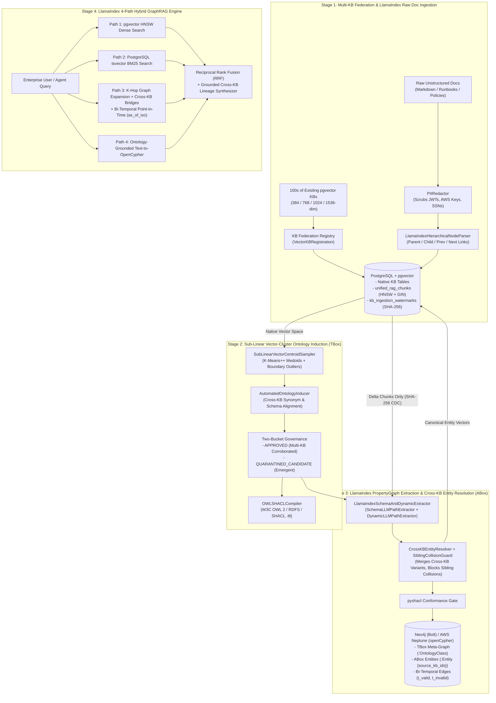

# Enterprise Multi-KB Automated Ontology & Knowledge Graph Fabric — Design & Explainer Guide

This guide explains the architectural design, algorithms, data models, and execution flows of **`enterprise-kg-ontology-fabric`** ([`src/enterprise_kg_fabric/`](../src/enterprise_kg_fabric/)), engineered to build **automated domain ontologies (TBox)** and **bi-temporal knowledge graphs (ABox)** from **100s of heterogeneous PostgreSQL `pgvector` embedding stores** and **raw unstructured document streams** using **LlamaIndex**, **Neo4j / Amazon Neptune (`openCypher`)**, and **PostgreSQL (`pgvector`)**.

---

## 1. The Core Problem: Why Building a Unified KG from 100s of Vector KBs is Hard

In a large enterprise, knowledge does not sit in a single clean folder of PDFs. Instead, it is fragmented across:
1. **100s of Pre-Existing `pgvector` Knowledge Bases**:
   - **SRE & Cloud Ops** has 20 KBs embedded with `bge-small-en-v1.5` (`384-dim`).
   - **FinOps & Cloud Economics** has 20 KBs embedded with `text-embedding-004` (`768-dim`).
   - **Regulatory Compliance & Legal** has 20 KBs embedded with `text-embedding-3-large` (`1536-dim`).
   - **SecOps, Customer SLA, and Data/ML Teams** have dozens more KBs (`768-dim` / `1024-dim`).
2. **Continuous Streams of Raw Unstructured Documents**:
   - Architecture runbooks, postmortems, compliance audits, and security bulletins arriving as Markdown/HTML/PDF files.

If you attempt to run a naive LLM triple extractor over all 100+ KBs, **four enterprise failure modes occur**:

| Failure Mode | What Goes Wrong in Naive Pipelines | How `enterprise-kg-ontology-fabric` Solves It |
| :--- | :--- | :--- |
| **1. LLM Token & Cost Explosion** | Passing 500,000 vector chunks across 100 KBs into an LLM just to discover the ontology costs thousands of dollars and overflows context windows. | **`SubLinearVectorCentroidSampler`**: Uses the native vectors already sitting in each KB's `pgvector` table to run **K-Means++ / MaxMin Diversity Medoid Seeding + Boundary Outlier Sampling**, compressing ontology induction volume by **60–97%** with zero re-embedding. |
| **2. "Spaghetti Ontology" Schema Drift** | KB #1 calls a service `Microservice`, KB #22 calls it `ServiceComponent`, KB #45 calls it `BackendService`, and relations drift (`DEPENDS_ON` vs `CALLS_UPSTREAM` vs `REQUIRES_SERVICE`). | **`AutomatedOntologyInducer`**: Aligns candidate classes and predicates across all 100+ KBs into a single governed `EnterpriseCompiledTBox` anchored to Layer-0 `UpperOntologyCategory`, storing `synonyms` and alias maps. |
| **3. Catastrophic Sibling Entity Merges** | Vector similarity between `payment-router-01` and `payment-router-02` (or `PCI-DSS-4.0` and `PCI-DSS-3.2`, or `us-east-1` and `eu-central-1`) is `>0.95`, causing vector-based entity resolvers to collapse distinct systems into one corrupted node. | **`CrossKBEntityResolver` + `SiblingCollisionGuard`**: Merges true cross-KB surface variations (`payment-router-01` ↔ `"Payment Router 01"`) while strictly blocking merges when numeric IDs, cloud regions, environments, or version numbers differ. |
| **4. Re-Extracting Unchanged Vector KBs** | Nightly batch runs re-extract 100% of rows across 100s of vector KBs even when only 0.1% of chunks changed. | **Incremental SHA-256 CDC Watermarks (`kb_ingestion_watermarks`)**: Tracks `(kb_id, chunk_id, content_sha256, tbox_version)` in PostgreSQL so incremental runs skip **99%+** of unchanged chunks in sub-millisecond time. |

---

## 2. Four-Stage End-to-End Pipeline Architecture

---

## 3. Deep-Dive Into Each Component

### 3.1 Stage 1: Multi-KB Federation & Raw Document Ingestion
* **File**: [`src/enterprise_kg_fabric/models.py`](../src/enterprise_kg_fabric/models.py), [`src/enterprise_kg_fabric/llama_index_bridge.py`](../src/enterprise_kg_fabric/llama_index_bridge.py)
* **Heterogeneous KB Registration (`VectorKBRegistration`)**:
  Each of your 100s of existing `pgvector` stores is registered with its Postgres schema/table name, column mapping (`VectorKBColumnMapping`), domain tag (`sre_cloud`, `finops_economics`, `regulatory_compliance`, `secops_threat_intel`, etc.), and native embedding dimension (`384`, `768`, `1024`, `1536`).
* **Raw Document Ingestion (`LlamaIndexHierarchicalNodeParser`)**:
  Raw documents are scrubbed of credentials (`Bearer <JWT>`, `AKIA...`, SSNs, credit cards) by `PIIRedactor`, split by Markdown section hierarchy into LlamaIndex `TextNode` chunks with `parent_node_id`, `prev_node_id`, and `next_node_id` relationships, and persisted with both native KB embeddings and canonical embeddings.

### 3.2 Stage 2: Sub-Linear Vector-Cluster Ontology Induction & Alignment
* **File**: [`src/enterprise_kg_fabric/vector_clustering.py`](../src/enterprise_kg_fabric/vector_clustering.py), [`src/enterprise_kg_fabric/ontology_inducer.py`](../src/enterprise_kg_fabric/ontology_inducer.py)
* **How `SubLinearVectorCentroidSampler` works**:
  1. **MaxMin Diversity / K-Means++ Furthest-Point Seeding**: Operates directly on each KB's native vectors (`chk.native_embedding`) without re-embedding. Picks $K$ maximally separated seed vectors in cosine distance.
  2. **Spherical Cluster Medoid Selection**: Assigns every chunk in the KB to its nearest seed, computes the L2-normalized cluster mean vector, and selects the real chunk closest to each cluster center (the **medoid**).
  3. **High-Entropy Boundary Outlier Capture**: Selects $B$ chunks furthest from all selected medoids so rare emergent concepts (such as a single Zero-Day advisory or new post-quantum cryptography control) are never missed by centroid averaging.
* **Cross-KB Synonym Alignment & Layer-0 Upper Ontology Anchoring**:
  - Every discovered class is anchored to one of 7 Layer-0 `UpperOntologyCategory` roots (`p:ActorOrOrg`, `p:SystemOrAsset`, `p:ProcessOrEvent`, `p:PolicyOrStandard`, `p:DataOrArtifact`, `p:LocationOrRegion`, `p:MetricOrFinancial`).
  - Vocabulary variations across divisions are automatically aligned:
    - `Microservice`, `BackendService`, `ServiceComponent`, `Workload` $\rightarrow$ **`CloudService`**
    - `StorageCluster`, `DataStore`, `LedgerDB` $\rightarrow$ **`DatabaseCluster`**
    - `CALLS_UPSTREAM`, `REQUIRES_SERVICE`, `BACKED_BY_DB` $\rightarrow$ **`DEPENDS_ON`**
    - `ALLOCATED_TO_COST_CENTER`, `FUNDED_BY_COST_CENTER` $\rightarrow$ **`OWNED_BY_PRIMARY`** (`is_functional=True`)
* **Two-Bucket Governance & W3C OWL 2 / SHACL Export (`OWLSHACLCompiler`)**:
  - Concepts corroborated across $\ge \text{min\_kb\_support}$ KBs are marked `OntologyStatus.APPROVED`.
  - Novel single-KB concepts (e.g. `PostQuantumCipherVault` and `PROTECTED_BY_LATTICE_KEM`) are quarantined in `OntologyStatus.QUARANTINED_CANDIDATE` until corroborated or promoted via `promote_quarantined_ontology_concepts()`.
  - `OWLSHACLCompiler.export_turtle(tbox)` compiles the TBox into a standard W3C OWL 2 + RDFS + SHACL `.ttl` file.

### 3.3 Stage 3: LlamaIndex Property Graph Construction, Cross-KB ER & Bi-Temporal Edges
* **File**: [`src/enterprise_kg_fabric/entity_resolution.py`](../src/enterprise_kg_fabric/entity_resolution.py), [`src/enterprise_kg_fabric/adapters/graph_stores.py`](../src/enterprise_kg_fabric/adapters/graph_stores.py)
* **Cross-KB Entity Resolution (`CrossKBEntityResolver`)**:
  - When SRE KB #001 mentions `payment-router-01` and FinOps KB #022 mentions `"Payment Router 01"`, they resolve to the same canonical vertex `ent::cloudservice::payment_router_01` with merged `source_kb_ids=["kb_001_sre_cloud", "kb_022_finops_economics", ...]` and `aliases=["payment-router-01", "Payment Router 01"]`.
* **Sibling Collision Guard (`SiblingCollisionGuard`)**:
  - Inspects normalized numeric sequences, cloud regions (`us-east-1` vs `eu-central-1`), environment tags (`prod` vs `staging`), and versions (`PCI-DSS-4.0` vs `PCI-DSS-3.2`).
  - Prevents `payment-router-01` and `payment-router-02` from ever merging even though their vector cosine similarity exceeds `0.95`.
* **Bi-Temporal Functional Edge Superseding (`t_valid`, `t_invalid`)**:
  - Functional predicates (`is_functional=True`, such as `DEPLOYED_IN_PRIMARY` and `OWNED_BY_PRIMARY`) can only have one active target at any point in time.
  - When KB #001 records `payment-router-01 --DEPLOYED_IN_PRIMARY--> us-east-1` (`t_valid = 2026-01-15`) and KB #014 later records a failover `payment-router-01 --DEPLOYED_IN_PRIMARY--> eu-central-1` (`t_valid = 2026-10-20`), the graph store automatically closes the older edge (`t_invalid = 2026-10-20T00:00:00Z`) and marks `eu-central-1` as `t_invalid = "ACTIVE"`.
  - Current queries return `eu-central-1`, while historical point-in-time queries (`as_of_iso="2026-06-01T00:00:00Z"`) accurately return `us-east-1`!

### 3.4 Stage 4: LlamaIndex 4-Path Hybrid GraphRAG Engine
* **File**: [`src/enterprise_kg_fabric/rag_engine.py`](../src/enterprise_kg_fabric/rag_engine.py)
* When a user or agent queries `service.query_graph_rag(request)`:
  1. **Path 1 (`pgvector` HNSW Dense Search)** + **Path 2 (`tsvector` GIN BM25 Lexical Search)** retrieve the top chunks across all KBs using Reciprocal Rank Fusion (RRF, $k=60$).
  2. **Path 3 (Multi-Hop PropertyGraph Expansion)** resolves seed entities from the query and top chunks, traverses $1..K$ hops in Neo4j / Amazon Neptune, and flags **Cross-KB Bridge Entities** (`is_cross_kb_bridge=True`) where a multi-hop path connects facts originating from different KB divisions (e.g., `payment-router-01` [SRE KB #001] $\rightarrow$ `aurora-ledger-01` [SRE KB #001] $\rightarrow$ `PCI-DSS-4.0` [Compliance KB #045]).
  3. **Path 4 (Ontology-Grounded Text-to-OpenCypher)** synthesizes and runs a parameterized OpenCypher query compatible with both Neo4j and AWS Neptune.

---

## 4. Module Reference Map

| File Path | Key Classes | Responsibility |
| :--- | :--- | :--- |
| [`src/enterprise_kg_fabric/models.py`](../src/enterprise_kg_fabric/models.py) | `VectorKBRegistration`, `EnterpriseCompiledTBox`, `KGEntityNode`, `KGRelationEdge`, `GraphRAGQueryResponse` | Core Pydantic v2 schemas for KBs, TBox ontology, bi-temporal ABox graph, and GraphRAG responses |
| [`src/enterprise_kg_fabric/vector_clustering.py`](../src/enterprise_kg_fabric/vector_clustering.py) | `SubLinearVectorCentroidSampler`, `SemanticFeatureHashEmbeddingProvider`, `GeminiOrFallbackEmbeddingProvider` | K-Means++ medoid & boundary outlier sampling in native `pgvector` space + multi-dim embedding providers |
| [`src/enterprise_kg_fabric/ontology_inducer.py`](../src/enterprise_kg_fabric/ontology_inducer.py) | `AutomatedOntologyInducer`, `OWLSHACLCompiler` | Automated bottom-up ontology discovery, cross-KB synonym alignment, Two-Bucket gating, and OWL/SHACL `.ttl` export |
| [`src/enterprise_kg_fabric/llama_index_bridge.py`](../src/enterprise_kg_fabric/llama_index_bridge.py) | `LlamaIndexHierarchicalNodeParser`, `LlamaIndexSchemaAndDynamicExtractor`, `PIIRedactor` | LlamaIndex hierarchical document chunking, PII scrubbing, and schema-guided + dynamic triple extraction |
| [`src/enterprise_kg_fabric/entity_resolution.py`](../src/enterprise_kg_fabric/entity_resolution.py) | `CrossKBEntityResolver`, `SiblingCollisionGuard` | Cross-KB entity deduplication and strict sibling numeric/region/version collision prevention |
| [`src/enterprise_kg_fabric/adapters/pgvector_store.py`](../src/enterprise_kg_fabric/adapters/pgvector_store.py) | `PostgresPgVectorStoreAdapter`, `InMemoryPgVectorStoreEmulator`, `get_production_pgvector_ddl` | Production `asyncpg` PostgreSQL + `pgvector` HNSW/GIN/RLS adapter, SHA-256 watermarks, and in-memory emulator |
| [`src/enterprise_kg_fabric/adapters/graph_stores.py`](../src/enterprise_kg_fabric/adapters/graph_stores.py) | `Neo4jOpenCypherGraphAdapter`, `NeptuneOpenCypherGraphAdapter`, `InMemoryOpenCypherGraphEmulator` | Production Neo4j Bolt & AWS Neptune (`boto3` `neptunedata` `/openCypher`) adapters and in-memory OpenCypher engine |
| [`src/enterprise_kg_fabric/rag_engine.py`](../src/enterprise_kg_fabric/rag_engine.py) | `EnterpriseHybridGraphRAGEngine` | LlamaIndex 4-Path Hybrid GraphRAG retriever with RRF fusion and OpenCypher synthesis |
| [`src/enterprise_kg_fabric/service.py`](../src/enterprise_kg_fabric/service.py) | `EnterpriseKGOntologyService` | High-level enterprise orchestrator across all 4 stages |
| [`src/enterprise_kg_fabric/api.py`](../src/enterprise_kg_fabric/api.py) | `create_kg_fabric_app` | FastAPI REST microservice (`/v1/kbs/*`, `/v1/documents/ingest`, `/v1/ontology/*`, `/v1/graph/build`, `/v1/rag/query`) |
